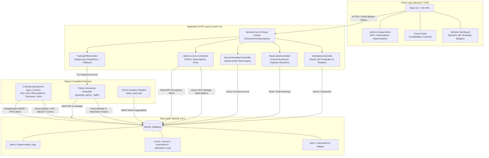
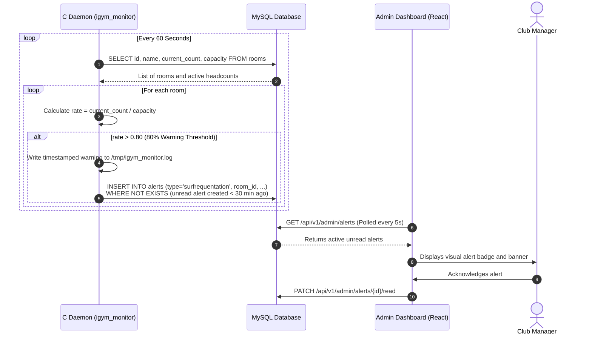

# I-gym

> A multi-tenant athletic club management and member engagement platform featuring dynamic QR access control, autonomous room occupancy monitoring via a C background daemon, deterministic workout recommendations, and automated PDF dossier generation.

---

## At a Glance

| Property | Details |
|---|---|
| **Author** | **Mohammed Reda EL GHASSIB** ([@reda3031](https://github.com/reda3031)) |
| **Repository** | [https://github.com/reda3031/I-gym](https://github.com/reda3031/I-gym) |
| **Target Roles** | Super Admin, Club Admin, Coach, Member (*Adhérent*) |
| **Primary Stack** | Laravel 13 (REST API) • React 18 + Vite (SPA) • C99 (System Daemon) • Python 3 (Analytics & PDF) • MySQL 8 |
| **Architectural Style** | Multi-service, single-database multi-tenancy (`gym_id` partitioning) with inter-process database integration |
| **Intelligence Model** | **Deterministic Rule Engine** (No AI/ML models; strictly domain-driven logic) |

---

## 30-Second Summary

**I-gym** is a full-stack, multi-tenant gym operations platform that solves the fragmentation common in fitness facilities—such as disconnected turnstiles, manual desk registers, and unmonitored room capacities. 

Built as a polyglot system, it combines:
1. A **Laravel 13 REST API** managing relational business logic, course scheduling, subscription lifecycles, and atomic QR token rotation.
2. A **React 18 (Vite + Tailwind)** single-page application with role-based routing guards, dark/light themes, and trilingual support (French, English, Arabic).
3. A compiled **C99 system daemon** monitoring facility occupancy at the OS level and issuing high-occupancy threshold warnings.
4. An analytical **Python 3 engine** compiling member attendance data into 3-page vector PDF training dossiers and analytical JSON reports.

---

## Key Highlights

- **Polyglot System Architecture**: Unites web application layers (PHP 8.3+/Laravel 13, React 18) with a compiled systems programming service (C99) and data-processing tooling (Python 3) communicating over a unified MySQL 8 schema.
- **Replay-Resistant Dynamic QR Rotation**: Eliminates static badge screenshot sharing. Every check-in executes an atomic transaction (`DB::transaction`) that validates active subscription dates, records attendance, updates streak counters, advances gamification tiers, and regenerates an ephemeral 64-character token (`Str::random(64)`).
- **Autonomous 80% Occupancy Warning Daemon**: A standalone C99 service connects natively via `libmysqlclient`, continuously inspecting room capacities every 60 seconds and logging high-occupancy warnings when utilization exceeds 80%, protected by a 30-minute SQL deduplication filter.
- **Strict Multi-Tenant Scoping & Audited Impersonation**: Club entities are partitioned by `gym_id`. Super Administrators can temporarily impersonate club admins, coaches, or members to diagnose issues; every session logs target IDs, administrator IDs, and IP addresses to `impersonation_logs`.
- **Deterministic Domain-Driven Recommendations**: Rule-based fitness matching engine (`RecommendationController.php`) pairs member goals with course taxonomies, training frequencies, and nutrition advice without artificial intelligence or machine learning overhead.
- **Automated Biometric & Training Dossier Generation**: Python service (`generate_pdf.py` via `fpdf2`) dynamically formats a 3-page vector PDF containing member metrics, weekly course calendars, and attendance history, with an automatic fallback in Laravel.

---

## Core Stakeholder Workflows

```
┌────────────────────────────────────────────────────────────────────────────────────────┐
│                                       I-GYM ROLES                                      │
├────────────────────┬────────────────────┬───────────────────────┬──────────────────────┤
│  MEMBER (Adhérent) │       COACH        │      CLUB ADMIN       │     SUPER ADMIN      │
├────────────────────┼────────────────────┼───────────────────────┼──────────────────────┤
│ • Dynamic QR Pass  │ • Availability Cal │ • Subscription Status │ • Multi-Club Metrics │
│ • Course Bookings  │ • Session Planning │ • Cash Validations    │ • Gym Onboarding     │
│ • Streak & Badges  │ • Member Feedback  │ • 80% Warning Alerts  │ • User Impersonation │
│ • 3-Page PDF Plan  │ • Challenge Events │ • Room & Course Setup │ • Audit Trail Logs   │
└────────────────────┴────────────────────┴───────────────────────┴──────────────────────┘
```

- **Gym Member (*Adhérent*)**: Uses single-use dynamic QR codes for access, books classes with real-time remaining spot counters, tracks consecutive workout streaks with milestone badges, receives deterministic fitness guidance, and downloads custom PDF dossiers.
- **Coach**: Manages coaching specialties, sets weekly availability matrices, schedules group courses, monitors attendee rosters, and reviews member feedback.
- **Club Administrator**: Manages club operations, validates in-person cash subscription payments, configures room capacities and opening hours, reviews real-time occupancy, acknowledges daemon-generated occupancy warnings, and inspects daily attendance trends.
- **Super Administrator**: Oversees the entire multi-tenant network, monitors cross-club revenue and occupancy metrics, provisions new gym branches, and performs audited support impersonations.

---

## System Architecture



---

## Detailed Feature Verification

### 1. Access Control & QR Token Rotation
- **Rotation Mechanism**: The member's QR code encodes `{ user_id, token, expires_at }`. When scanned, `AttendanceController::checkIn` executes within a database transaction (`DB::transaction`).
- **Validation**: Verifies that the user exists and holds an active subscription (`end_date >= today` and `status = 'active'`).
- **Atomic State Update**: Increments room `current_count`, updates consecutive workout streak days, increments total lifetime sessions, updates gamification level (`bronze`, `silver`, `gold`, `platinum`), and assigns any newly earned badges.
- **Immediate Token Rotation**: Generates a new 64-character token (`$user->qr_token = Str::random(64)`) and saves it before committing the transaction. Any existing screenshot or reuse attempt immediately fails verification with HTTP 422.
- **Check-Out Handling**: When members leave, `POST /attendance/check-out` sets `checked_out_at = NOW()` on the active attendance record and decrements the corresponding room's `current_count`.

### 2. Room Occupancy Monitoring & Daemon Alerting
- **Room Status Taxonomy**: Defined in `Room.php`:
  - `low`: 0% to 50% occupancy
  - `medium`: 51% to 80% occupancy
  - `high`: 81% to 99% occupancy
  - `full`: 100% capacity
- **80% High-Occupancy Warning vs. Over-Capacity**:
  - The C daemon (`daemon/monitor.c`) evaluates `rate = current_count / capacity`.
  - When `rate > 0.80` (80% threshold), it emits a **high-occupancy warning** (`surfrequentation`) to alert gym managers to crowding *before* the room reaches absolute capacity.
  - Actual **100% capacity limits** are enforced at the reservation level by `ReservationController::store`, which prevents bookings when confirmed counts meet `max_capacity`.
- **Deduplication Query**: The daemon avoids flooding the database by inserting alerts only when no unread alert exists for that room within the last 30 minutes:
  ```sql
  INSERT INTO alerts (type, message, room_id, is_read, created_at, updated_at)
  SELECT 'surfrequentation', '...', room_id, 0, NOW(), NOW()
  WHERE NOT EXISTS (
      SELECT 1 FROM alerts
      WHERE room_id = ? AND is_read = 0
      AND created_at > DATE_SUB(NOW(), INTERVAL 30 MINUTE)
  );
  ```

### 3. Subscription State Machine & Access Guarding
- **Status Lifecycle**: Subscriptions transition across `pending`, `active`, `expiring_soon`, `expired`, and `suspended`.
- **Active Subscription Middleware**: `CheckActiveSubscription.php` inspects incoming member requests. Unwhitelisted endpoints return HTTP 403 (`subscription_inactive`) if the member lacks an active plan, redirecting them to a subscription locked screen.
- **Expiration Warnings**: `User::checkUpcomingExpirations` issues multi-stage notifications at 7 days, 3 days, and on the expiration day (with duplicate suppression).
- **Administrative Payment Validation**: Cash payments collected at the front desk are validated by administrators via `POST /admin/subscriptions/{id}/validate`, transitioning plans from `pending` to `active`.

### 4. Deterministic Workout Recommendations
- **Domain-Driven Engine**: Implemented in `RecommendationController::recommend`. It accepts a member's target objective (`perte_de_poids`, `prise_de_masse`, `endurance`, `flexibilite`) and evaluates static domain rules:
  - *Weight Loss (`perte_de_poids`)*: Maps to Cardio, HIIT, and Zumba (3x/week schedule).
  - *Muscle Gain (`prise_de_masse`)*: Maps to Strength and Crossfit (4x/week schedule).
  - *Endurance (`endurance`)*: Maps to Cardio and HIIT (5x/week schedule).
  - *Flexibility (`flexibilite`)*: Maps to Yoga and Pilates (3x/week schedule).
- **Catalog Matching**: Queries active, upcoming courses matching these categories and returns open spots, scheduling information, and assigned instructors.

### 5. Automated PDF Document Generation
- **Script**: `analytics/generate_pdf.py` (424 lines of Python using `fpdf2`).
- **Structure**:
  - *Page 1 (Biometric Profile)*: Member name, emergency contacts, objective, tier status, lifetime stats, and earned badges.
  - *Page 2 (Weekly Plan)*: 7-day course schedule mapped to the member's target objective, complete with room assignments and coaching guidance.
  - *Page 3 (Attendance History)*: Table of the 10 most recent verified check-ins and coach notes.
- **Subprocess Execution with Fallback**: `TrainingPdfController` invokes the script via `exec("python3 generate_pdf.py --user_id={id}")`. If Python or `fpdf2` is absent, it invokes `generateFallbackPdf`, returning a basic document to prevent request failure.

---

## Core Workflows

### 1. Dynamic QR Check-In & Anti-Replay Rotation

```mermaid
sequenceDiagram
    autonumber
    actor Member as Member (Mobile App)
    participant UI as React Client
    participant API as Laravel AttendanceController
    participant DB as MySQL Database
    actor Scanner as Front Desk Scanner

    Member->>UI: View Member Dashboard
    UI->>UI: Render QR with current user.qr_token
    Scanner->>API: POST /attendance/check-in { qr_token }
    API->>DB: Query user by qr_token
    alt Token invalid or expired
        API-->>Scanner: 422 Unprocessable (Invalid QR code)
    else User identified
        API->>DB: Check subscription (status='active' AND end_date >= today)
        alt Subscription expired or pending
            API-->>Scanner: 200 OK { status: 'denied', reason: 'expired' }
        else Subscription is active
            rect rgb(30, 41, 59)
                Note over API,DB: Atomic Transaction (DB::transaction)
                API->>DB: INSERT into attendance_logs (user_id, room_id, status='granted')
                API->>DB: Increment room current_count
                API->>DB: Update streak_days, total_sessions, and level tier
                API->>DB: Rotate qr_token = Str::random(64)
                API->>DB: Unlock eligible milestone badges
            end
            API-->>Scanner: 200 OK { status: 'granted', new_qr_token }
            UI->>Member: Display Granted animation & refresh badge counter
        end
    end
```



### 2. High-Occupancy Warning & Escalation Workflow



---

## Technology Stack

| Layer | Technology | Verified Version | Purpose in Codebase |
|---|---|---|---|
| **Frontend** | React | 18.2.0 | Reactive component-based single-page application |
| | Vite | 5.1.0 | Fast frontend build tool and development server |
| | Tailwind CSS | 3.4.1 | Design system, responsive layouts, and dark mode |
| | React Router DOM | 6.22.0 | Role-guarded routing (`super_admin`, `admin`, `coach`, `adherent`) |
| | Recharts | 2.12.0 | Data visualizations (occupancy gauges, charts, heatmaps) |
| | Axios | 1.6.0 | HTTP client with Bearer auth and 401 response interceptors |
| | react-qr-code | 2.0.12 | Dynamic client-side SVG QR code rendering |
| | Lucide React | 0.344.0 | UI iconography |
| | canvas-confetti | 1.9.3 | Micro-interactions for streaks and badge unlocks |
| **Backend** | PHP | `^8.3` / `^8.4` | Server-side execution environment |
| | Laravel Framework | 13.x (`^13.8`) | REST API framework, Eloquent ORM, and database migrations |
| | Laravel Sanctum | 4.3 (`^4.3`) | Stateless token-based API authentication |
| **Daemon** | C (C99) | GCC / Clang | Low-overhead system service for background facility monitoring |
| | libmysqlclient | MySQL C Client API | Direct MySQL connection and query execution |
| | systemd | Linux service | Process supervision (`igym.service`) with auto-restart |
| **Analytics** | Python | 3.9+ | Data processing and automated report compilation |
| | fpdf2 | 2.7.9 | Vector PDF rendering for personalized training plans |
| | mysql-connector-python | 8.3.0 | Direct MySQL query execution for batch analytical jobs |
| | pandas / matplotlib | 2.2.0 / 3.8.0 | Tabular data analysis and plot dependencies |
| **Database** | MySQL | 8.0+ | Relational persistence engine (InnoDB, foreign keys, transactions) |

---

## Project Structure

```
I-gym/
├── analytics/                   # Python analytics & document generation service
│   ├── generate_pdf.py          # 3-page customized workout dossier generator (fpdf2)
│   ├── requirements.txt         # Python package dependencies
│   └── stats_report.py          # Daily statistical aggregation pipeline (JSON exporter)
├── backend/                     # Laravel 13 REST API application
│   ├── app/
│   │   ├── Http/
│   │   │   ├── Controllers/API/ # 13 API Controllers (Attendance, Admin, Gym, etc.)
│   │   │   └── Middleware/      # CheckActiveSubscription access guard
│   │   └── Models/              # 21 Eloquent models (User, Room, Course, Gym, etc.)
│   ├── bootstrap/               # Application bootstrap and provider configuration
│   ├── config/                  # App, database, CORS, and Sanctum configurations
│   ├── database/
│   │   ├── migrations/          # 28 database schema migrations
│   │   └── seeders/             # DatabaseSeeder with multi-club fixtures
│   ├── routes/
│   │   └── api.php              # RESTful API route definitions (prefix: v1)
│   ├── composer.json            # PHP dependencies and autoloading definitions
│   └── .env.example             # Backend environment template
├── daemon/                      # C room monitoring system service
│   ├── igym.service             # systemd service unit definition for Linux deployment
│   ├── Makefile                 # C compilation script with dynamic MySQL path detection
│   └── monitor.c                # C99 daemon source (libmysqlclient, signal handling)
├── docs/                        # Architecture and reference documentation
│   ├── api.md                   # REST API contract and endpoint specifications
│   ├── database.md              # Database schema documentation and ER diagram
│   ├── python-analytics.md      # Python execution guide and PDF generation guide
│   └── setup-c-daemon.md        # C daemon compilation, configuration, and systemd guide
└── frontend/                    # React 18 + Vite frontend client
    ├── public/                  # Static assets and illustration files
    ├── src/
    │   ├── components/          # Reusable UI elements, gauges, and layouts
    │   │   ├── charts/          # Recharts RadialBarChart gauges (OccupancyGauge.jsx)
    │   │   ├── gamification/    # StreakCard.jsx, LeaderboardWidget.jsx
    │   │   ├── layout/          # Sidebar.jsx, Header.jsx, Layout.jsx
    │   │   └── qr/              # Dynamic QRDisplay.jsx with check-in animation
    │   ├── context/             # AuthContext, ThemeContext, TranslationContext
    │   ├── hooks/               # usePolling.js, useNotifications.js, useChartTheme.js
    │   ├── pages/               # 18 page views (adherent, coach, admin, superadmin, etc.)
    │   ├── services/            # Axios instance and API request interceptors
    │   ├── App.jsx              # Application router and role-based guards
    │   └── main.jsx             # React application DOM entry point
    ├── package.json             # Frontend dependencies and npm scripts
    ├── tailwind.config.js       # Tailwind CSS design system configuration
    └── vite.config.js           # Vite development server configuration
```

---

## Getting Started

### Prerequisites

Ensure the following runtimes and tools are installed:

- **PHP**: `^8.3` or `^8.4` with `pdo_mysql`, `mbstring`, `openssl`, and `tokenizer` extensions
- **Composer**: Dependency manager for PHP
- **Node.js**: `v18+` or `v20+` and `npm`
- **MySQL Server**: `8.0+`
- **Python**: `3.9+` and `pip`
- **C Compiler**: `gcc` or `clang` with `libmysqlclient` development headers (for the daemon)

---

### Step 1: Database Initialization

Create a database in your local MySQL instance:

```sql
CREATE DATABASE igym CHARACTER SET utf8mb4 COLLATE utf8mb4_unicode_ci;
```

---

### Step 2: Backend (Laravel API)

1. Navigate to the backend directory:
   ```bash
   cd backend
   ```

2. Install PHP dependencies:
   ```bash
   composer install
   ```

3. Set up environment configuration:
   ```bash
   cp .env.example .env
   php artisan key:generate
   ```
   *Edit `.env` to supply your MySQL credentials (`DB_USERNAME`, `DB_PASSWORD`).*

4. Run migrations and populate the test fixtures:
   ```bash
   php artisan migrate --seed
   ```

5. Link the public storage directory:
   ```bash
   php artisan storage:link
   ```

6. Start the development server:
   ```bash
   php artisan serve --port=8000
   ```
   *The API will be available at `http://localhost:8000/api/v1`.*

---

### Step 3: Frontend (React + Vite)

1. Navigate to the frontend directory:
   ```bash
   cd ../frontend
   ```

2. Install Node.js packages:
   ```bash
   npm install
   ```

3. Launch the Vite development server:
   ```bash
   npm run dev
   ```
   *The client interface will run at `http://localhost:5173`.*

---

### Step 4: Python Analytics & PDF Service

1. Navigate to the analytics directory:
   ```bash
   cd ../analytics
   ```

2. Install Python dependencies:
   ```bash
   pip3 install -r requirements.txt
   ```

3. Test running the daily statistical pipeline:
   ```bash
   python3 stats_report.py
   ```

4. Test generating a personalized 3-page workout dossier:
   ```bash
   python3 generate_pdf.py --user_id=3
   ```

---

### Step 5: C Room Monitoring Daemon (Optional System Service)

1. Navigate to the daemon directory:
   ```bash
   cd ../daemon
   ```

2. Compile the monitor binary:
   - **Linux (Ubuntu/Debian)**:
     ```bash
     sudo apt-get install libmysqlclient-dev
     make
     ```
   - **macOS (Homebrew)**:
     ```bash
     brew install mysql-client
     gcc -o igym_monitor monitor.c \
         -I$(brew --prefix mysql-client)/include/mysql \
         -L$(brew --prefix mysql-client)/lib \
         -lmysqlclient -lpthread
     ```

3. Start the process:
   ```bash
   ./igym_monitor &
   ```
   *Activity logs will stream to `/tmp/igym_monitor.log`.*

---

## Configuration & Environment Variables

### Backend (`backend/.env`)

```ini
APP_NAME="I-Gym"
APP_ENV=local
APP_KEY=base64:YOUR_GENERATED_APP_KEY_HERE
APP_DEBUG=true
APP_URL=http://localhost:8000

# Database Configuration
DB_CONNECTION=mysql
DB_HOST=127.0.0.1
DB_PORT=3306
DB_DATABASE=igym
DB_USERNAME=your_db_username
DB_PASSWORD=your_db_password

# CORS & Sanctum Allowed Client Domains
SANCTUM_STATEFUL_DOMAINS=localhost:5173
FRONTEND_URL=http://localhost:5173
```

### Python Analytics

| Variable | Default Value | Description |
|---|---|---|
| `DB_HOST` | `127.0.0.1` | MySQL host |
| `DB_PORT` | `3306` | MySQL port |
| `DB_DATABASE` | `igym` | MySQL database name |
| `DB_USERNAME` | `root` | Database user |
| `DB_PASSWORD` | *(empty)* | Database password |
| `REPORT_DIR` | `../backend/storage/reports` | Output directory for statistical JSON reports |

---

## Development Seed Accounts

> [!WARNING]
> **DEVELOPMENT ONLY SECURITY NOTICE**
> The accounts below are seeded exclusively by `DatabaseSeeder.php` for local demonstration, development, and portfolio evaluation. All seeded test accounts share the default password `password`. **Never deploy seeded development fixtures or default credentials to a production environment.**

| Role | Email | Club Branch | Purpose |
|---|---|---|---|
| **Super Admin** | `superadmin@igym.ma` | Global (All Clubs) | Cross-club platform administration & user impersonation |
| **Club Admin** | `admin@igym.ma` | FitZone Casablanca | Primary club operations, alert monitoring, and subscriptions |
| **Club Admin** | `admin_rabat@igym.ma` | PowerHouse Rabat | Secondary club branch management |
| **Coach** | `coach@igym.ma` | FitZone Casablanca | Session scheduling, roster reviews, and coach profile |
| **Member** | `ahmed@igym.ma` | FitZone Casablanca | Active member with streaks, badges, and reservations |

---

## Project Status

- [x] **Backend REST API**: Complete (Laravel 13 API with Sanctum authentication, middleware guards, and 28 database migrations).
- [x] **Frontend Web Client**: Complete (React 18 + Vite SPA with multi-role routing, dark/light themes, and Arabic/French/English translations).
- [x] **C Monitoring Daemon**: Complete (C99 daemon with Makefile, MySQL C client library integration, and Linux systemd service unit).
- [x] **Python Analytics & PDF Engine**: Complete (3-page vector PDF generation script and JSON statistical reporting pipeline).
- [ ] **Automated Test Coverage**: Feature and unit tests currently consist of base framework templates; expanded automated test coverage across edge-case transaction rollbacks is in development.
- [ ] **Hardware Turnstile Integration**: The access control logic is fully functional via software REST API calls; physical relay board/MQTT turnstile hardware integration remains a future roadmap milestone.
- [ ] **Visual Assets & Media**: UI screenshots and recorded video walkthroughs are planned for future documentation updates (no authentic UI captures are bundled in the repository).

---

## Author

**Mohammed Reda EL GHASSIB**
- GitHub: [@reda3031](https://github.com/reda3031)
- Repository: [https://github.com/reda3031/I-gym](https://github.com/reda3031/I-gym)
