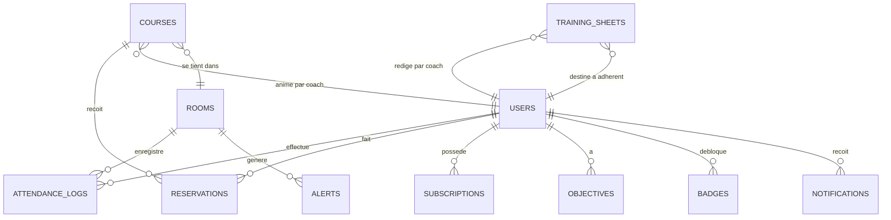

# I-Gym — Documentation Base de Données

## ERD (Entity Relationship Diagram)

## Dictionnaire de Données

### Table `users`
| Colonne | Type | Description |
|---------|------|-------------|
| id | BIGINT PK | Identifiant unique |
| name | VARCHAR | Nom complet |
| email | VARCHAR UNIQUE | Email de connexion |
| password | VARCHAR | Hash bcrypt |
| role | ENUM(adherent,coach,admin) | Rôle utilisateur |
| phone | VARCHAR NULL | Téléphone |
| avatar | VARCHAR NULL | Photo de profil |
| objective_type | ENUM | Objectif fitness |
| streak_days | INT | Jours consécutifs |
| total_sessions | INT | Total séances |
| level | ENUM(bronze,silver,gold,platinum) | Niveau gamification |
| qr_token | VARCHAR UNIQUE | Token QR (régénéré après chaque scan) |
| last_session_date | DATE | Dernière séance (calcul streak) |

### Table `rooms`
| Colonne | Type | Description |
|---------|------|-------------|
| id | BIGINT PK | Identifiant |
| name | VARCHAR | Nom de la salle |
| capacity | INT | Capacité maximale |
| current_count | INT | Personnes présentes (temps réel) |

### Table `subscriptions`
| Colonne | Type | Description |
|---------|------|-------------|
| id | BIGINT PK | Identifiant |
| user_id | FK → users | Adhérent |
| plan | ENUM(mensuel,trimestriel,annuel) | Formule |
| price | DECIMAL | Prix payé |
| start_date | DATE | Début abonnement |
| end_date | DATE | Fin abonnement |
| status | ENUM(active,expired,pending) | Statut |

### Table `courses`
| Colonne | Type | Description |
|---------|------|-------------|
| id | BIGINT PK | Identifiant |
| name | VARCHAR | Nom du cours |
| coach_id | FK → users | Coach animateur |
| room_id | FK → rooms | Salle |
| starts_at | DATETIME | Début |
| ends_at | DATETIME | Fin |
| max_capacity | INT | Capacité max |
| current_reservations | INT | Réservations actuelles |
| type | ENUM | Type de cours |

### Table `reservations`
| Colonne | Type | Description |
|---------|------|-------------|
| id | BIGINT PK | Identifiant |
| user_id | FK → users | Adhérent |
| course_id | FK → courses | Cours réservé |
| status | ENUM(confirmed,cancelled) | Statut |
| reserved_at | TIMESTAMP | Date réservation |

### Table `attendance_logs`
| Colonne | Type | Description |
|---------|------|-------------|
| id | BIGINT PK | Identifiant |
| user_id | FK → users | Adhérent |
| room_id | FK → rooms | Salle |
| qr_token | VARCHAR | Token utilisé au scan |
| checked_in_at | TIMESTAMP | Entrée |
| checked_out_at | TIMESTAMP NULL | Sortie (NULL = en cours) |
| status | ENUM(granted,denied) | Résultat accès |

### Table `badges`
| Colonne | Type | Description |
|---------|------|-------------|
| id | BIGINT PK | Identifiant |
| user_id | FK → users | Propriétaire |
| badge_type | ENUM | Type de badge |
| earned_at | TIMESTAMP | Date obtention |

### Table `notifications`
| Colonne | Type | Description |
|---------|------|-------------|
| id | BIGINT PK | Identifiant |
| user_id | FK → users | Destinataire |
| type | ENUM | Type notification |
| title | VARCHAR | Titre |
| message | TEXT | Corps du message |
| is_read | BOOLEAN | Lu/Non lu |
| action_url | VARCHAR NULL | Lien action |

### Table `alerts`
| Colonne | Type | Description |
|---------|------|-------------|
| id | BIGINT PK | Identifiant |
| type | VARCHAR | Type alerte |
| message | TEXT | Message |
| room_id | FK → rooms NULL | Salle concernée |
| is_read | BOOLEAN | Traitée ou non |

## Index importants
- `users.qr_token` — UNIQUE (recherche rapide au scan)
- `users.email` — UNIQUE
- `attendance_logs(user_id, checked_out_at)` — pour calcul occupation temps réel
- `reservations(user_id, course_id)` — UNIQUE COMPOSITE (prévention doublons)
